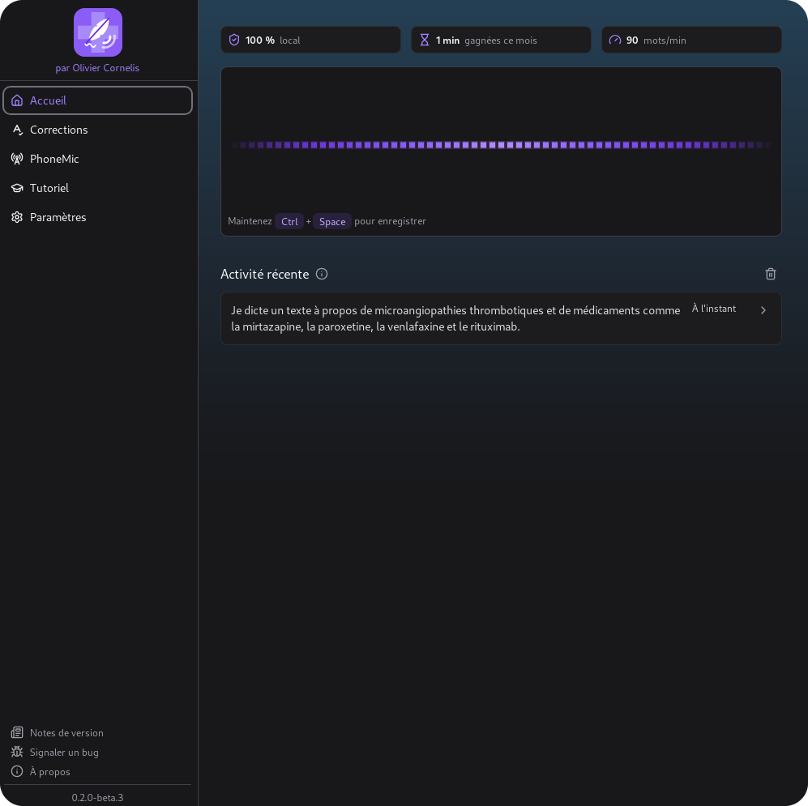

# Plumed

Plumed est une application de dictée vocale respectueuse de la confidentialité, réalisée par [Olivier Cornelis](https://olicorne.org/fr), interne en psychiatrie et développeur.

Plumed n'est pas un projet commercial et est donc **entièrement gratuite et sans pub**, ne nécessite **pas de compte**, ne piste pas ses utilisateurs, **tourne directement sur votre ordinateur**, **fonctionne hors ligne** une fois le modèle téléchargé et permet de dicter dans **n'importe quelle application** (logiciel métier, traitement de texte, messagerie, etc.), avec une reconnaissance adaptée au **vocabulaire médical français** (médicaments, termes médicaux, comptes rendus, ...).

**Site et documentation : [plumed.fr](https://plumed.fr)**

Plumed n'est cependant pas (encore ?) un dispositif médical certifié : l'application est fournie telle quelle, sans garantie autre que sa [politique de confidentialité](PRIVACY_POLICY.md). De principe, il convient de ne pas utiliser d'information identifiante (noms de patients, ...) dans Plumed.

## Installation

Téléchargement direct de la dernière version stable :

| Système                              | Fichier                                                                                                             |
| ------------------------------------ | ------------------------------------------------------------------------------------------------------------------- |
| Windows (x64)                        | [Plumed_x64-setup.exe](https://github.com/PlumedOrg/Plumed/releases/latest/download/Plumed_x64-setup.exe)           |
| Linux Debian, Ubuntu                 | [Plumed_amd64.deb](https://github.com/PlumedOrg/Plumed/releases/latest/download/Plumed_amd64.deb)                   |
| Linux Fedora, openSUSE               | [Plumed_amd64.rpm](https://github.com/PlumedOrg/Plumed/releases/latest/download/Plumed_amd64.rpm)                   |
| Linux Arch                           | [Plumed_amd64.pkg.tar.zst](https://github.com/PlumedOrg/Plumed/releases/latest/download/Plumed_amd64.pkg.tar.zst)   |
| Linux (autres distributions)         | [Plumed_amd64.AppImage](https://github.com/PlumedOrg/Plumed/releases/latest/download/Plumed_amd64.AppImage)         |
| macOS Apple Silicon (M1 et suivants) | [Plumed_aarch64_darwin.dmg](https://github.com/PlumedOrg/Plumed/releases/latest/download/Plumed_aarch64_darwin.dmg) |
| macOS Intel                          | [Plumed_x86_64_darwin.dmg](https://github.com/PlumedOrg/Plumed/releases/latest/download/Plumed_x86_64_darwin.dmg)   |

Les versions bêta sont sur la [page des releases](https://github.com/PlumedOrg/Plumed/releases), et Plumed peut aussi les proposer lui-même (canal bêta dans **Paramètres > En ligne**).

Windows et macOS affichent un avertissement au premier lancement (l'application n'est pas signée par un certificat payant), et la saisie directe sous Wayland demande une règle udev : voir le [guide d'installation](https://plumed.fr/docs/installation/).

## Fonctionnalités

- **[Dictée par raccourci clavier](https://plumed.fr/docs/fonctionnalites/dictee/)** dans n'importe quelle application, sur Windows, macOS et Linux.
- **Fonctionne hors ligne** : la reconnaissance et les corrections tournent sur l'ordinateur, internet ne sert qu'aux [fonctions facultatives](https://plumed.fr/docs/fonctionnalites/en-ligne/) listées dans **Paramètres > En ligne**.
- **[Corrections en 8 étapes](https://plumed.fr/docs/fonctionnalites/corrections/)** adaptées au vocabulaire médical, dont environ 45 000 [corrections de noms de médicaments et de termes médicaux](https://plumed.fr/docs/fonctionnalites/medicaments/) et les règles de dictée d'UltiMed (« 15 mg par kilo par jour » devient « 15 mg/kg/j »).
- **[Textes types](https://plumed.fr/docs/fonctionnalites/textes-types/)** : une phrase dite est remplacée par un texte plus long, utile pour les modèles répétitifs.
- **[Contexte pour les dictées courtes](https://plumed.fr/docs/fonctionnalites/dictees-courtes/)** : un mot isolé est mieux reconnu grâce à la fin de la dictée précédente.
- **[PhoneMic](https://plumed.fr/docs/fonctionnalites/phonemic/)** (expérimental) : le téléphone sert de micro, l'audio étant chiffré de bout en bout jusqu'à l'ordinateur.
- **[API de transcription locale](https://plumed.fr/docs/fonctionnalites/api-locale/)** (désactivée par défaut) : vos programmes peuvent faire transcrire des fichiers WAV par Plumed, avec vos corrections, via une API compatible OpenAI.
- **Tutoriel** intégré dans la barre latérale.

## Confidentialité

La reconnaissance se fait sur votre ordinateur : l'audio et les transcriptions ne sont jamais envoyés sur internet. Une fois le modèle de reconnaissance vocale téléchargé, Plumed fonctionne entièrement hors ligne. Voir la [politique de confidentialité](PRIVACY_POLICY.md) et la [liste des connexions réseau](https://plumed.fr/docs/fonctionnalites/en-ligne/).

## Remerciements et licences

Plumed est initialement un fork de [Murmure](https://github.com/Kieirra/murmure) qui intègre les fonctionnalités du mode médical de [ParakeetWeb](http://parakeetweb.olicorne.org/?mode=med) et les modèles [UltiMed](https://github.com/UltiMed-Org). UltiMed et ParakeetWeb sont du même auteur que Plumed.

Plumed est un logiciel libre sous licence [GNU AGPL v3](LICENSE), comme Murmure.

- **[Murmure](https://www.murmure.app/)** par [Al1x-ai](https://www.al1x-ai.com/) : l'application dont Plumed est un fork (AGPL v3, [code source](https://github.com/Kieirra/murmure)). Soutenez le projet original !
- **[ParakeetWeb](https://github.com/thiswillbeyourgithub/parakeet_web)** : dont le mode médical était un précurseur de Plumed (AGPL v3).
- **[UltiMed](https://github.com/UltiMed-Org)** : les modèles de reconnaissance vocale [UltiMed v1](https://huggingface.co/Olicorne/parakeet-tdt-0.6b-v3-ultra-UltiMed-v1-onnx) et [UltiMed v2](https://huggingface.co/Olicorne/parakeet-tdt-0.6b-v3-ultra-UltiMed-v2-onnx) (CC BY 4.0), et ses [règles de correction des médicaments et termes médicaux](https://github.com/UltiMed-Org/UltiMed-ASR-FR-v2-regex-fixes) (AGPL-3.0-or-later), construites à partir des données ouvertes françaises sur le médicament.
- **[UltiMed-ASR-FR-v2-regex-fixes](https://github.com/UltiMed-Org/UltiMed-ASR-FR-v2-regex-fixes)** (liste `dictation_rules.csv`) : règles de dictée médicale (unités, constantes, ponctuation dictée), proposées par défaut comme règles de formatage (AGPL-3.0-or-later).
- **[LPSN](https://lpsn.dsmz.de/)** (List of Prokaryotic names with Standing in Nomenclature) : noms de bactéries inclus dans la liste d'amplification de phrases, sous licence [CC BY-SA 4.0](https://creativecommons.org/licenses/by-sa/4.0/). Citation requise : Parte, A.C., Sardà Carbasse, J., Meier-Kolthoff, J.P., Reimer, L.C. & Göker, M. (2020). List of Prokaryotic names with Standing in Nomenclature (LPSN) moves to the DSMZ. _International Journal of Systematic and Evolutionary Microbiology_ 70, 5607-5612. https://doi.org/10.1099/ijsem.0.004332
- **[Grammalecte](https://grammalecte.net)** par Olivier R. : le correcteur grammatical de l'étape 7 des corrections, version 2.3.0 (GNU GPL v3 ou ultérieure), inclus sans modification (sa version JavaScript, celle de l'extension Firefox) avec sa licence. Sources : [le paquet inclus](https://addons.mozilla.org/firefox/downloads/file/4643560/grammalecte_fr-2.3.0.xpi) et [l'archive des sources de la même version](https://grammalecte.net/zip/Grammalecte-fr-v2.3.0.zip). Détails dans [src-tauri/grammar-data/SOURCE.md](src-tauri/grammar-data/SOURCE.md).

Le détail des règles médicales incluses (provenance, mise à jour) est dans [src-tauri/medical-data/SOURCE.md](src-tauri/medical-data/SOURCE.md).
